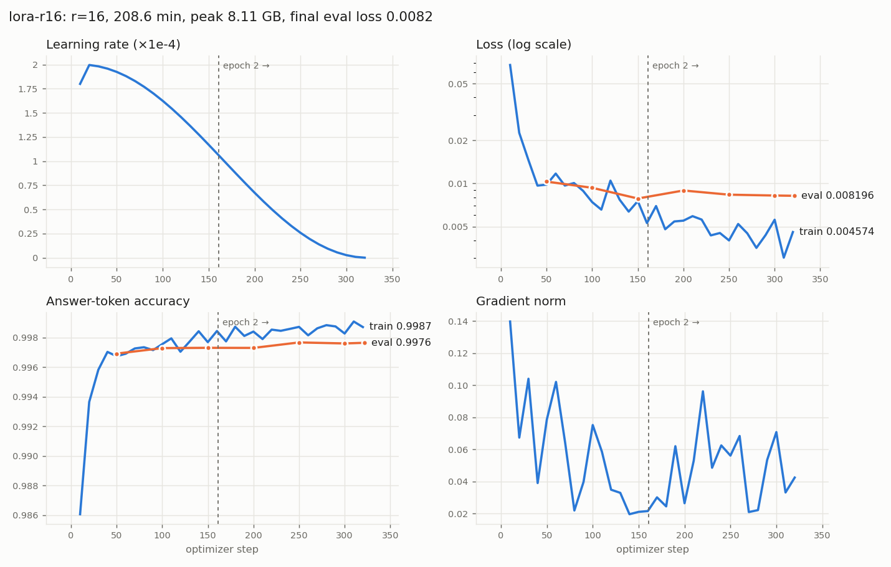

# Hands-on LLM Fine-Tuning, Quantization and Serving

A guided project for learning the three core skills of running your own LLM, on one GPU
server:

1. **Serving**: running a model behind an API with vLLM, and understanding what limits speed and concurrency.
2. **Fine-tuning**: teaching a model new behaviour with LoRA / QLoRA.
3. **Quantization**: shrinking a model to 8 or 4 bits and measuring what you gain and lose.

The approach is **measure, change one thing, measure again**. You start by benchmarking the
untouched base model. Each later step (fine-tuning, quantizing) is compared against that baseline
with the same two tools:

* `scripts/evaluate.py`: **quality**, measured as perplexity on held-out answers plus sample outputs you read yourself
* `scripts/benchmark.py`: **speed**, measured as latency and throughput at different concurrency levels

`scripts/report.py` puts every run into a single comparison table. By the end you'll have
real numbers from your own hardware, which teach far more than any blog post.

## Roadmap

| Step | What you do | What you learn |
|---|---|---|
| **A. Setup** | | |
| 0 | Check the server | What hardware limits you |
| 1 | Set up Python environments | Why the ML stack needs isolated environments |
| 2 | Download the base model | Model files, formats, memory math |
| 3 | Prepare training data | Chat templates, prompt/completion format |
| **B. Serving basics** | | |
| 4 | Serve the base model and call it | vLLM, the OpenAI-compatible API, the KV cache |
| 5 | Measure the baseline | Perplexity, TTFT, TPOT, throughput |
| **C. Fine-tuning** | | |
| 6 | Fine-tune with QLoRA | LoRA, QLoRA, the training loop, loss curves |
| 7 | Evaluate the adapter | Did fine-tuning actually help? |
| 8 | Serve the adapter (multi-LoRA) | Serving adapters without merging |
| **D. Quantization** | | |
| 9 | Merge the adapter | Folding LoRA into the weights |
| 10 | Quantize: FP8, INT8, INT4 | Post-training quantization, calibration |
| 11 | Evaluate and benchmark quantized models | The size / speed / quality trade-off |
| **E. Production** | | |
| 12 | Deploy the chosen model | systemd, API keys, exposing it safely |
| ★ | Experiments | Going deeper on your own |

Plan on roughly a weekend for A–C and another for D–E. Training time depends on your GPU and
dataset size.

---

## Key concepts (read once, refer back later)

**Memory math.** Model weights take *parameters × bytes per parameter*. For a 7B model:

| Precision | Bytes/param | 7B weights |
|---|---|---|
| FP32 | 4 | ~28 GB |
| BF16 / FP16 | 2 | ~15 GB |
| FP8 / INT8 | 1 | ~7.5 GB |
| INT4 | 0.5 | ~4.5 GB (incl. scales) |

Training needs much more than the weights: gradients, optimizer state and activations. That's
why full fine-tuning a 7B model needs more than 80 GB, while QLoRA fits in about 12–16 GB.

**LoRA.** Instead of updating a huge weight matrix `W` (d×d), you freeze it and learn a small
update `ΔW = B·A`, where `A` is r×d and `B` is d×r, with rank `r` around 8–64. That's about 1%
of the parameters, so gradients and optimizer state are tiny. `lora_alpha / r` scales how
strongly the update is applied.

**QLoRA.** Same as LoRA, but the frozen base is stored in 4-bit (NF4) and dequantized on the
fly during each forward pass. The LoRA weights stay in 16-bit. It saves a lot of memory and
costs a little speed and, usually, a negligible amount of quality.

**Post-training quantization (PTQ).** After training, store weights (and optionally activations)
in fewer bits:
* *Weight-only* (W4A16, W8A16): smaller model, faster when **memory-bound** (low concurrency, where decoding reads all the weights for every token).
* *Weights + activations* (W8A8 INT8, FP8): the matmuls themselves run in 8-bit, faster when **compute-bound** (high concurrency).
* *Calibration*: running a few hundred real samples through the model to pick good scales. It matters most for INT4 and INT8.

**Serving (vLLM).** Each in-flight request keeps a **KV cache** (the attention keys and values
of every token so far) in GPU memory. vLLM's *PagedAttention* stores it in blocks like virtual
memory, and *continuous batching* lets new requests join a running batch. VRAM left after the
weights goes to KV cache, and **more KV cache means more concurrent users and longer contexts**.
Quantization helps serving partly by freeing memory for KV cache.

**Serving metrics.**
* **TTFT** (time to first token): prefill plus queueing time. It's the lag a user notices.
* **TPOT** (time per output token): decode speed for each user.
* **Throughput** (output tokens/s across all users): what the GPU delivers in total.

As concurrency rises, throughput rises and per-user TPOT gets worse. Finding that balance is
the core skill of serving.

---

# A. Setup

## Step 0: Check the server

**Learn:** VRAM, not system RAM, decides which model you can use.

```bash
git clone git@github.com:nikhilktn/LLM_FineTuning_Serving.git && cd LLM_FineTuning_Serving
bash scripts/check_env.sh
```

**Look for:**
* **GPU name, memory and `compute_cap`.** Compute capability decides which quantization kernels are fast:
  * 8.0 / 8.6 (Ampere: A100, A10, RTX 30xx): INT8 and INT4 are fast. FP8 runs weight-only.
  * 8.9 (Ada: L4, L40S, RTX 40xx) and 9.0 (Hopper: H100): FP8 is fully accelerated.
* **"CUDA Version" in `nvidia-smi`**: 12.x. Newer drivers are better for recent vLLM.
* **Free disk**: at least 150 GB. You'll keep base, merged and three quantized copies.

**Common problems:**
* `Failed to initialize NVML: Driver/library version mismatch`: the driver was upgraded, but
  the old kernel module is still loaded. Reboot. If it persists, check `dkms status`. Afterwards,
  pin the driver so an automatic upgrade can't break a training run:
  `sudo apt-mark hold $(dpkg -l | awk '/^ii/ && $2 ~ /nvidia/ {print $2}')`
* Python below 3.10: use `/usr/bin/python3` (3.12 on Ubuntu 24.04) for the environments in Step 1.

**About your 64 GB RAM + 32 GB swap:** that's system memory. It matters when loading
checkpoints and merging. Swap never helps the GPU, and a job that starts swapping slows to a
crawl.

**Model by VRAM** (the default in all commands is `Qwen/Qwen2.5-7B-Instruct`):

| VRAM | Model | Train with |
|---|---|---|
| 12–16 GB | `Qwen/Qwen2.5-3B-Instruct` | QLoRA |
| 24 GB | `Qwen/Qwen2.5-7B-Instruct` | QLoRA |
| 40–48 GB | 7B, or `Qwen/Qwen2.5-14B-Instruct` | 7B: bf16 LoRA; 14B: QLoRA |
| 80 GB | 14B, or 32B | 14B: bf16 LoRA; 32B: QLoRA |

If you change the model, change every `models/...` / `--model` path below to match.

### This server: RTX 4000 SFF Ada, 20 GB, compute capability 8.9, ~280 GB/s, 70 W

**Plan:** Qwen2.5-7B-Instruct, trained with QLoRA. bf16 LoRA on 7B doesn't fit in 20 GB, so
experiment 1 (LoRA vs QLoRA) has to use `Qwen/Qwen2.5-3B-Instruct`. Ada has FP8 tensor cores,
so all three quantization schemes run on fast kernels.

**Predict before you measure.** These are back-of-envelope numbers. Write them down, then
compare them with the vLLM startup log (Step 4) and `benchmark.py` (Steps 5 and 11).

KV cache per token for Qwen2.5-7B is 2 (K and V) × 28 layers × 4 KV heads × 128 dims ×
2 bytes ≈ **56 KB**. Memory available at `GPU_UTIL=0.90` is about 19.3 GB, minus about 1.5 GB of
activation and CUDA-graph overhead.

| Model | Weights | Left for KV cache | ≈ KV cache tokens | Decode ceiling at concurrency 1 (bandwidth ÷ weight bytes) |
|---|---|---|---|---|
| bf16 | ~15.2 GB | ~2.6 GB | ~45k | ~18 tok/s (~55 ms/token) |
| FP8 / W8A8 | ~8.7 GB (embeddings + `lm_head` stay bf16) | ~9 GB | ~160k | ~32 tok/s |
| W4A16 | ~5.5 GB | ~12 GB | ~215k | ~50 tok/s |

Real decode speed usually reaches 70–85% of the ceiling. If your measurements are far off,
find out why: that's where the learning is.

## Step 1: Set up Python environments

**Learn:** vLLM, the training stack and llm-compressor each pin their own PyTorch and
transformers versions. Putting them in one environment is the most common source of
breakage, so use three:

```bash
sudo apt-get update && sudo apt-get install -y python3-venv python3-dev git tmux

# Use the system Python (3.12 on Ubuntu 24.04), not an older python3 earlier on your PATH.
PY=/usr/bin/python3; $PY --version
for env in train quant serve; do
  $PY -m venv ~/venvs/$env
  ~/venvs/$env/bin/pip install --upgrade pip
  ~/venvs/$env/bin/pip install -r requirements-$env.txt
done

~/venvs/train/bin/python -c "import torch; print(torch.__version__, torch.cuda.is_available(), torch.cuda.get_device_name(0))"
~/venvs/serve/bin/python -c "import vllm; print(vllm.__version__)"
~/venvs/quant/bin/python -c "import llmcompressor; print(llmcompressor.__version__)"
```

If `cuda.is_available()` prints `False`, install the PyTorch wheel for your CUDA version from
https://pytorch.org/get-started/locally/ in that environment first.

**Smoke-test the GPU path training uses** (bf16 matmul, attention, bitsandbytes 4-bit forward
and backward):

```bash
~/venvs/train/bin/python scripts/smoke_test_gpu.py     # must end with "ALL OK"
```

`is_available() == True` only proves the driver loaded. Real kernels can still fail if pip
installed a torch built for a **newer CUDA minor version than your driver supports** (e.g.
`+cu132` on a CUDA 13.0 driver). If the smoke test fails with `unsupported toolchain`,
`no kernel image` or a bitsandbytes CUDA error, reinstall torch built for your driver's CUDA:

```bash
~/venvs/train/bin/pip install --force-reinstall "torch==2.14.1" --index-url https://download.pytorch.org/whl/cu130
```

The requirements files pin the versions this repo was tested with (transformers 5.22.1,
TRL 1.17.1, PEFT 0.21.2, vLLM 0.33.0, llm-compressor 0.15.0). Major upgrades rename
arguments, so upgrade on purpose, not by accident.

## Step 2: Download the base model

**Learn:** what a model on the Hub actually is.

```bash
source ~/venvs/train/bin/activate
hf auth login        # token from https://huggingface.co/settings/tokens (older CLI: huggingface-cli login)
python scripts/download_model.py --model Qwen/Qwen2.5-7B-Instruct --out models/base
ls -lh models/base
cat models/base/config.json
```

**Look for:**
* `*.safetensors`: the weights, split into shards. Total size ≈ params × 2 bytes (bf16).
* `config.json`: the architecture. Note `hidden_size`, `num_hidden_layers`, `num_attention_heads`, `num_key_value_heads` (GQA, which shrinks the KV cache) and `torch_dtype`.
* `tokenizer_config.json`: contains the **chat template**, the Jinja code that turns a
  `messages` list into the exact string the model was trained on, with tokens like `<|im_start|>`.

## Step 3: Prepare training data

**Learn:** what models actually see during training.

Training rows use conversational **prompt/completion** format. Loss is computed only on the
completion, so the model learns to *answer*, not to repeat the question:

```json
{"prompt": [{"role": "system", "content": "..."}, {"role": "user", "content": "Question"}],
 "completion": [{"role": "assistant", "content": "Answer"}]}
```

### This project's dataset: 10-K financial statement extraction

The task is: **financial statement text in → fixed JSON of key figures out**. That's a skill
(reading a table, finding the current-year column, keeping signs and units right, writing
`null` instead of guessing), not memorised facts, so it suits LoRA well and its accuracy can be
measured exactly.

Labels come free from **inline XBRL**. Since about FY2019, every number in a 10-K's statements
is tagged in the HTML with its concept, period, unit and scale. `build_10k_dataset.py`:

1. finds the income statement, balance sheet and cash flow tables (the tables with the most
   current-year, non-segment XBRL facts),
2. renders each as plain text with its heading, which becomes the **prompt**,
3. builds the **answer JSON** from the XBRL tags inside that same table,
4. holds out about 10% of **companies** per sector for eval, so eval measures generalisation
   to unseen companies rather than memorised ones.

```bash
source ~/venvs/train/bin/activate
pip install lxml
python scripts/build_10k_dataset.py --input-dir data/raw/10k --sectors data/raw/10k/sectors.csv --out-dir data
```

Data used: the main 10-K document (not exhibits or 10-K/A amendments) for FY2020 and FY2024 of each
S&P 500 company, falling back to a neighbouring year when a filing has no inline XBRL: 983 filings,
2,872 examples (2,585 train from 441 companies, 287 eval from 49 held-out companies). Every
numeric label appears in its prompt.
The years are 4 apart because statements show 2–3 years of comparatives, and this way no
number appears in both filings.

**Look for:**
- **Label coverage** printed at the end. `null` is often correct: banks have no "current
  assets", and many companies don't report gross profit. The model has to learn not to invent
  these.
- Open a few rows of `data/eval.jsonl` and compare the prompt table with the answer JSON
  yourself.

**Transfer test (later):** 60 Nifty 500 FY2024-25 annual reports in `data/raw/annual_reports/`
(PDF, ₹ crore, Ind AS) for checking whether the skill carries over to Indian filings.

### Other data sources

The script converts Alpaca-style (`instruction` / `input` / `output`) and chat-style
(`messages`) data:

```bash
# Option 1: your own data (recommended once the pipeline works)
python scripts/prepare_data.py --input data/raw/my_data.jsonl --out-dir data --system-prompt "You are ..."

# Option 2: start with a public dataset to learn the pipeline
python scripts/prepare_data.py --hf-dataset yahma/alpaca-cleaned --max-samples 3000 --out-dir data
```

**Choose a task where you can see the change.** Generic instruction data barely changes an
instruct model. Good learning tasks have a distinctive output: a fixed JSON schema, a specific
tone or persona, domain Q&A from your own documents, or SQL generation for your schema.

**Try:** view the exact string the model trains on:

```bash
python -c "
import json; from transformers import AutoTokenizer
t = AutoTokenizer.from_pretrained('models/base'); r = json.loads(open('data/train.jsonl').readline())
print(t.apply_chat_template(r['prompt'] + r['completion'], tokenize=False))"
```

---

# B. Serving basics

## Step 4: Serve the base model and call it

**Learn:** how vLLM uses GPU memory.

```bash
tmux new -s vllm
source ~/venvs/serve/bin/activate
[ -f ~/.vllm_api_key ] || (openssl rand -hex 24 > ~/.vllm_api_key && chmod 600 ~/.vllm_api_key)   # a random key you create
MODE=model MODEL_PATH=models/base SERVED_NAME=base bash scripts/serve_vllm.sh
# detach: Ctrl-b d
```

**About the API key:** it isn't issued by vLLM or Hugging Face. It's a random password you
create, and vLLM rejects any request whose `Authorization: Bearer <key>` header doesn't match.
The script reads it from `~/.vllm_api_key`, and so do the Python clients.

**tmux basics:** `tmux ls` lists sessions. `tmux attach -t vllm` reattaches. Inside tmux,
Ctrl-b d detaches, a green status bar shows at the bottom, and `echo $TMUX` is non-empty.
A server started *outside* tmux stops when your SSH session closes.

**From your laptop:** the server listens on `127.0.0.1` only. Tunnel to it with
`ssh -N -L 8000:localhost:8000 admin@<server>`, then use `http://localhost:8000` locally.

**Read the startup log.** It explains vLLM's memory use:
* `Model loading took X GiB`: the weights (about 15 GiB for 7B bf16).
* `# GPU blocks: N` / `KV cache size: N tokens` / `Maximum concurrency for 8192 tokens per request: Kx`:
  the memory left for KV cache after the weights, and how many full-length requests fit at
  once. **Write these down.** You'll compare them after quantizing.

**The KV cache size depends on whether vLLM compiled on this start.** vLLM compiles the model
with `torch.compile` and caches the result under `~/.cache/vllm/torch_compile_cache`, keyed by
model and settings (including `MAX_MODEL_LEN`). The first start with a new combination compiles
(`Compiling a graph ... takes X s`), and that compile inflates the memory the startup profile
measures. Measured on the 7B model with every setting held equal:

| Start | Log line | Peak activation | KV cache |
|---|---|---|---|
| Cold (compiles) | `Compiling a graph for compile range (1, 2048)` | 1.45 GiB | 1.67 GiB, 31,280 tokens |
| Warm (cache hit) | `Directly load AOT compilation from path ...` | 0.94 GiB | 2.18 GiB, 40,880 tokens |

So **restart once and read the second start's numbers**, or pin the cache with
`--kv-cache-memory=<bytes>` (the log suggests a value). `MAX_MODEL_LEN` doesn't change the KV
cache: a warm start gives 40,880 tokens at both 4096 and 8192, because the startup profile runs
one batch of `max_num_batched_tokens` (2048 here), not one maximum-length sequence.
`MAX_MODEL_LEN` changes only how many full-length requests fit, and whether one fits at all. At
32768, a cold start failed: one request needs 1.75 GiB of KV cache (32,768 × 56 KiB) and only
1.67 GiB was left.

Call it from a second shell:

```bash
source ~/venvs/serve/bin/activate && export VLLM_API_KEY=$(cat ~/.vllm_api_key)
curl -s localhost:8000/v1/models -H "Authorization: Bearer $VLLM_API_KEY" | python -m json.tool
curl -s localhost:8000/v1/chat/completions -H "Content-Type: application/json" -H "Authorization: Bearer $VLLM_API_KEY" \
  -d '{"model": "base", "messages": [{"role": "user", "content": "What is a KV cache?"}], "max_tokens": 200}' | python -m json.tool
python scripts/chat_client.py --model base --stream
curl -s localhost:8000/metrics | grep -E "^vllm:(num_requests|gpu_cache_usage)"   # Prometheus metrics
```

**Try:** restart with `MAX_MODEL_LEN=32768` and then `GPU_UTIL=0.7`, and watch how
"Maximum concurrency" changes.

## Step 5: Measure the baseline

**Learn:** the numbers every later step is judged against.

With the server from Step 4 still running:

```bash
python scripts/eval_extraction.py --model base --label base   # task accuracy, all eval examples
python scripts/benchmark.py --model base --label base         # speed
```

Then stop the server (`tmux attach -t vllm`, Ctrl-C), because offline evaluation needs the GPU:

```bash
python scripts/evaluate.py --model models/base --label base
python scripts/report.py
```

**Look for:**
* **Benchmark:** from concurrency 1 to 32, throughput (tok/s) should rise a lot while TPOT gets
  only slightly worse. That's continuous batching at work. At concurrency 1, decoding is
  memory-bound: TPOT ≈ weight bytes ÷ GPU memory bandwidth. Check this against your GPU's
  bandwidth spec. Each level uses fresh prompts: vLLM's **prefix caching** (on by default) makes
  repeated prompts nearly free to prefill, which would fake a low TTFT.
* **Extraction accuracy:** the metric that matters for this task. *Field accuracy* is the
  share of fields exactly right. *Exact match* is the share of statements with every field
  right. *Hallucination rate* is how often the model gives a number where the answer is `null`
  (e.g. a calculated gross profit). Also check `outcomes` for **sign errors**, and the average
  output tokens (verbose answers are slower). Every prediction is in
  `results/extract_base.json`, so read some of the wrong ones.
* **Perplexity:** how "surprised" the base model is by your reference answers. Fine-tuning
  should lower it.
* **Samples** in `results/eval_base.json`: read them. This is your "before" picture.

---

# C. Fine-tuning

## Step 6: Fine-tune with QLoRA

**Learn:** the training loop, LoRA hyperparameters, reading loss curves.

Make sure vLLM is stopped (`nvidia-smi` should show no processes). Then:

```bash
tmux new -s train
source ~/venvs/train/bin/activate
python scripts/train_lora.py \
    --model models/base --train-file data/train.jsonl --eval-file data/eval.jsonl \
    --output-dir outputs/qwen7b-lora --qlora \
    --epochs 2 --lr 2e-4 --batch-size 2 --grad-accum 8 --max-length 2048 \
    --lora-r 16 --lora-alpha 32
```

Watch it in two more shells:

```bash
watch -n 2 nvidia-smi                                   # memory and utilisation
tensorboard --logdir outputs --host 127.0.0.1 --port 6006   # loss curves, every run in outputs/
# on your laptop: ssh -N -L 6006:localhost:6006 user@server, then open http://localhost:6006
```

**What each setting does:**
* `trainable params: ~40M || all params: ~7.6B || trainable%: ~0.5`: printed at start. That's LoRA.
* Effective batch = `batch-size × grad-accum` = 16. `grad-accum` trades time for memory.
* `--lr 2e-4` is high compared with full fine-tuning (~1e-5). LoRA tolerates and needs it.
* Gradient checkpointing recomputes activations in the backward pass instead of storing them, saving memory at about 30% extra time. Turn it off with `--no-gradient-checkpointing` if memory allows.
* **On this server** (RTX 4000 SFF Ada, 70 W): about 35 s/step, so roughly 3 hours for 2 epochs. Training is compute-bound, so the card hits its 70 W power cap and clocks down to about 1.2 of 3.1 GHz (`nvidia-smi` throttle reason `0x4`, SW power cap). Serving decode is memory-bound and doesn't suffer as much.

**Reading the curves:**
* `train/loss` drops fast at first, then flattens. A sudden jump to `nan` means the learning rate is too high or there's an fp16 overflow.
* `eval/loss` should follow it down. **If eval loss turns upward while train loss keeps
  falling, the model is overfitting.** Use the checkpoint from before the turn, fewer epochs,
  or more data.
* `outputs/qwen7b-lora/train_summary.json` records time, **peak GPU memory** and final eval
  loss. Keep it for the experiments.

**Save the curves with the results** (`outputs/` is git-ignored):

```bash
python scripts/plot_training.py --run-dir outputs/qwen7b-lora --label lora-r16 --steps-per-epoch 161
```

This writes `results/train_lora-r16.json` (summary plus every logged scalar) and a chart. Our run
(2 epochs, 322 steps, 208.6 min, peak 8.11 GB):



* **Learning rate:** 10-step warmup to 2e-4, then a cosine decay to 0.
* **Loss:** train loss falls from 0.067 to about 0.01 in the first 40 steps; most of the
  learning happens there. After that it only polishes.
* **Eval loss is lowest at step 150 (0.0078), near the end of epoch 1.** It rises to 0.0089 at
  step 200, then settles at 0.0082, while train loss keeps falling to about 0.004. That widening
  gap is the start of memorising the training companies: the second epoch bought nothing on
  held-out data. Mild, not harmful, but one epoch would have done (half the time).
* **Gradient norm** stays small (0.02 to 0.14) with no spikes: the learning rate is safe.

**If you run out of memory:** `--batch-size 1 --grad-accum 16`, then lower `--max-length`.
**To resume:** `--resume outputs/qwen7b-lora/checkpoint-XXX`.

## Step 7: Evaluate the adapter

**Learn:** whether fine-tuning helped, judged by numbers and by reading outputs.

```bash
source ~/venvs/train/bin/activate
python scripts/test_adapter.py --base models/base --adapter outputs/qwen7b-lora/final \
    --prompt "<a prompt typical of your task>"

source ~/venvs/serve/bin/activate
MODE=lora ./scripts/serve_vllm.sh        # in tmux; the adapter is served as "my-lora"
python scripts/eval_extraction.py --model my-lora --label lora-r16
# stop the server, then:
python scripts/evaluate.py --model models/base --adapter outputs/qwen7b-lora/final --label lora-r16
python scripts/report.py
```

**Our result** (287 examples from 49 unseen companies):

| | base | lora-r16 |
|---|---|---|
| Field accuracy | 82.5% | **97.9%** |
| Exact match | 33.8% | **88.5%** |
| Hallucination rate | 69.1% | **8.9%** |
| Sign errors | 51 | **3** |
| Perplexity | 1.1168 | **1.0072** |

**Read the errors, not just the score.** The first scoring gave the adapter 97.0% and 15.9%
hallucination. Most "hallucinations" turned out to be the right number on a correctly named line,
tagged with an XBRL concept the builder didn't know (equity including NCI when there is no NCI,
cash including restricted cash, `ProfitLoss` for net income). After adding those concepts to
`build_10k_dataset.py`, the saved predictions were re-scored without the GPU:

```bash
cp data/eval.jsonl data/eval_v1.jsonl     # the file the predictions were made on
python scripts/build_10k_dataset.py
python scripts/rescore_extraction.py --old-eval-file data/eval_v1.jsonl \
    results/extract_base.json results/extract_lora-r16.json
```

Perplexity needs the model, so it was re-run on the rebuilt data (`evaluate.py`, server stopped).
Both models dropped (base 1.1306 → 1.1168, lora-r16 1.0088 → 1.0072): the fixed labels are the
numbers the models were already predicting.

The base model's hallucination rate barely moved (71.8% → 69.1%): it really does calculate
missing lines. The adapter's halved. Evaluation labels are part of the experiment; check them
before trusting a number.

**Look for:**
* **Perplexity** of `lora-r16` should be clearly lower than `base`.
* **Side-by-side outputs:** does the fine-tuned model follow your format, tone or domain?
* **Side effects:** ask a few general questions outside your task. Heavy fine-tuning can cause
  *catastrophic forgetting*, where the model gets worse at things it used to do.

## Step 8: Serve the adapter (multi-LoRA)

**Learn:** vLLM can serve the base model plus several adapters from one GPU and pick one per
request, by the `model` field. Requests for different adapters share one batch: the base
weights are read once per decode step, and each request adds its own small `x·A·B` (a
"punica"/SGMV kernel applies a different adapter to each row of the batch). That's how one
GPU serves many fine-tunes, and what it costs is what this step measures.

**Prediction.** An adapter adds 81 MB of weights to the 15.2 GB read every decode step (+0.5%),
but 196 extra small matmuls per token. Expect TPOT 5–15% higher than `base` at 1 user, and the
gap to narrow as the batch grows. Merging (Step 9) removes it.

### 8.1 Start the server with two adapters

The final adapter, plus the step-250 checkpoint as a second one (less trained; see Step 6's
eval-loss curve). Any PEFT checkpoint directory works as an adapter.

```bash
tmux new -s vllm
cd ~/LLM_FineTuning_Serving && source ~/venvs/serve/bin/activate
MODE=lora SERVED_NAME=base ADAPTER_NAME=my-lora ADAPTER_PATH=outputs/qwen7b-lora/final \
  EXTRA_LORAS="ckpt250=outputs/qwen7b-lora/checkpoint-250" \
  ./scripts/serve_vllm.sh
```

In the startup log, note the KV-cache size and whether this start compiled or loaded from the
compile cache (see Step 4). A cold start leaves about 10K fewer KV-cache tokens.

### 8.2 One server, three models

```bash
curl -s localhost:8000/v1/models -H "Authorization: Bearer $(cat ~/.vllm_api_key)" | python -m json.tool
python scripts/chat_client.py --model base    --prompt "What is EBITDA? One sentence."
python scripts/chat_client.py --model my-lora --prompt "What is EBITDA? One sentence."
```

`/v1/models` lists `base`, `my-lora` and `ckpt250`; the adapters show `"parent": "base"`.

### 8.3 Benchmark: what does the adapter cost?

Same settings as Step 5, so the numbers line up in the report. Run benchmarks before any other
traffic: prefix caching would otherwise reuse earlier prompts and flatter TTFT (the cache is kept
per adapter, so `base` and `my-lora` don't share it).

```bash
B="--concurrency 1,4,8,16,32 --max-tokens 128"
python scripts/benchmark.py --model base    --label base-on-lora-server $B
python scripts/benchmark.py --model my-lora --label lora-r16 $B
python scripts/report.py
```

* `base-on-lora-server` vs `lora-r16`: the per-request cost of applying the adapter.
* `base` (Step 5) vs `base-on-lora-server` is **not** a clean comparison at high concurrency:
  the Step 5 server had a bigger KV cache.

**Our result.** KV cache: 40,880 tokens in Step 5 (a warm start), 30,832 for this LoRA server (a
cold start), and 31,280 for the merged server's cold start in Step 9. LoRA itself costs only ~450
tokens (~25 MB). The other ~10K tokens were the cold compile, not LoRA and not the context
length (an earlier version of this README blamed each in turn; Step 9's restarts settled it).
That smaller cache is why `base` at 32 users fell from 223.6 tok/s (Step 5) to 194.2: fewer
sequences fit in the cache at once. Applying the adapter added a steady ~5% to TPOT at every concurrency (54.7 → 57.4 ms
at 1 user, 118.7 → 126.5 ms at 32) and ~11% to TTFT, since prefill runs it on every prompt token.
The overhead doesn't shrink with batch size: the adapter's work grows with the number of tokens,
while the base weights are read once per step either way.

### 8.4 Mixed traffic: two adapters in one batch

Two clients at once, each with 16 users on a different adapter. **Restart the server first**
(Ctrl-C, then the 8.1 command): 8.3 put these prompts in `my-lora`'s prefix cache but not in
`ckpt250`'s, which would make the comparison unfair.

```bash
python scripts/benchmark.py --model my-lora --label mixed-my-lora --concurrency 16 --max-tokens 128 &
python scripts/benchmark.py --model ckpt250 --label mixed-ckpt250 --concurrency 16 --max-tokens 128
wait
```

Add their two `tok/s @16` together and compare with `lora-r16` at 32 users: if the totals are
close, batching across adapters costs little. Our run: TPOT 120.5 ms with 16 + 16 users on two
adapters vs 126.5 ms with 32 users on one, so mixing adapters in a batch costs nothing
measurable. Compare TPOT rather than summed tok/s: the two clients don't start and finish at
exactly the same time, so each one's tok/s covers a different window. With more distinct adapters than `--max-loras`,
requests wait for a free slot (adapters are swapped in from CPU, up to `--max-cpu-loras`).

### 8.5 Quality: final adapter vs step 250

```bash
python scripts/eval_extraction.py --model ckpt250 --label lora-r16-step250
python scripts/report.py
```

Step 6's eval loss was lower in mid-training than at the end. Does the step-250 checkpoint
extract as well as the final one? Loss and field accuracy don't always agree.

**Our result.** Step 250: 97.7% field accuracy and 87.5% exact match, against the final adapter's
97.9% and 88.5%. The two gave identical answers on 283 of 287 tables, and the final one fully
fixed 3 more tables. That 3–0 is within noise (a 1-point exact-match gap is about half the
±1.9-point standard error at n=287). By step 250 the cosine schedule had cut the learning rate to
3e-5, so the last 72 steps made only small adjustments. To test whether the second epoch was
needed, compare at the epoch boundary (step 161): keep that checkpoint with `--save-steps`, or
train with `--epochs 1`.

### 8.6 (Optional) Load an adapter at runtime

Restart the server with `VLLM_ALLOW_RUNTIME_LORA_UPDATING=True` in front of the command, then:

```bash
K="Authorization: Bearer $(cat ~/.vllm_api_key)"
curl -s localhost:8000/v1/load_lora_adapter -H "$K" -H "Content-Type: application/json" \
  -d '{"lora_name": "ckpt300", "lora_path": "outputs/qwen7b-lora/checkpoint-300"}'
python scripts/chat_client.py --model ckpt300
curl -s localhost:8000/v1/unload_lora_adapter -H "$K" -H "Content-Type: application/json" \
  -d '{"lora_name": "ckpt300"}'
```

This is how a platform adds a customer's fine-tune without restarting. Anyone with the API key
can load files from the server's disk this way, so leave it off in production.

---

# D. Quantization

## Step 9: Merge the adapter

**Learn:** `W_merged = W + (alpha/r)·B·A`. After merging it's an ordinary model again: no
adapter overhead when serving, and quantization tools (Step 10) need a plain model.

**What merging costs: bf16 rounding.** The adapter's changes are tiny (median 8e-5 against
weights of about 1e-2), and bf16 keeps only about 3 significant digits, so adding them rounds a
lot of the update away. Measured on three layers of our adapter:

| Layer | Weights left unchanged by the merge | Error in the stored update |
|---|---|---|
| L10 gate_proj | 24% | 21% |
| L10 q_proj | 25% | 24% |
| L27 down_proj | 60% | 41% |

Served as an adapter (Step 8), `x·W` and `x·A·B` are computed separately, so nothing is lost.
Merged, the update is distorted by 20–40%. It's still small next to the whole layer (the update
is under 1% of `W`, so the error is ~0.2% of the layer output), and the rounding is random rather
than systematic. Prediction: the merged model matches `lora-r16` within noise, with a few answers
flipping either way.

### 9.1 Merge (CPU, about 5 minutes)

The merge runs in system RAM (about 16 GB for 7B), so it doesn't need the GPU. Stop vLLM anyway,
since the next steps serve the merged model.

```bash
tmux attach -t vllm        # Ctrl-C, then Ctrl-b d
cd ~/LLM_FineTuning_Serving && source ~/venvs/train/bin/activate
python scripts/merge_lora.py --base models/base --adapter outputs/qwen7b-lora/final --out models/merged-qwen7b
```

### 9.2 Check what you got

```bash
du -sh models/base models/merged-qwen7b          # both ~15 GB: merging adds no size
ls models/merged-qwen7b                          # model-*.safetensors, config.json, tokenizer; no adapter files
python - <<'EOF'
from safetensors import safe_open
import glob, torch
keys = [k for f in glob.glob("models/merged-qwen7b/*.safetensors") for k in safe_open(f, "pt").keys()]
print(len(keys), "tensors; LoRA tensors left:", sum("lora" in k for k in keys))
name = "model.layers.10.mlp.gate_proj.weight"
get = lambda d: next(safe_open(f, "pt").get_tensor(name) for f in glob.glob(f"{d}/*.safetensors") if name in safe_open(f, "pt").keys())
base, merged = get("models/base"), get("models/merged-qwen7b")
print(name, merged.dtype, "share of weights changed:", f"{(base != merged).float().mean():.0%}")
EOF
```

Expect 339 tensors (the same as the base model), 0 LoRA tensors, bf16, and about 76% of that layer's
weights changed.

**Our result:** both 15 GB, 4 safetensors shards plus tokenizer files, 339 tensors, 0 LoRA tensors,
bf16, 76% of `L10 gate_proj` changed. That 76% is the other side of the table above: the 24% left
unchanged are weights whose update was smaller than half a bf16 step and rounded away.

### 9.3 Serve it and measure quality

```bash
source ~/venvs/serve/bin/activate
MODE=model MODEL_PATH=models/merged-qwen7b SERVED_NAME=merged ./scripts/serve_vllm.sh   # in tmux
```

The first start compiles the merged model, so the log shows about 31,280 KV-cache tokens: the LoRA
server's 30,832 plus the ~450 tokens LoRA reserves. A restart loads the compile cache and gives
40,880, like Step 5 (see Step 4). Then, in the serve venv:

```bash
python scripts/benchmark.py --model merged --label merged --concurrency 1,4,8,16,32 --max-tokens 128
python scripts/eval_extraction.py --model merged --label merged
python scripts/compare_extraction.py results/extract_lora-r16.json results/extract_merged.json
```

Run the benchmark first, so the prefix cache is empty.

### 9.4 Perplexity (stop the server first)

`evaluate.py` runs vLLM offline, so it needs the GPU to itself and the serve venv:

```bash
source ~/venvs/serve/bin/activate
python scripts/evaluate.py --model models/merged-qwen7b --label merged
python scripts/report.py
```

**Our result:**

| | lora-r16 (adapter) | merged |
|---|---|---|
| TPOT @1 | 57.39 ms | **54.63 ms** (base on the same server: 54.68) |
| tok/s @32 | 182.6 | **194.4** (base on the same server: 194.2) |
| TTFT p50 @1 | 337.4 ms | **304.7 ms** |
| Field accuracy / exact match / hallucination | 97.9% / 88.5% / 8.9% | 97.9% / 88.5% / 8.9% |
| Answers identical to the adapter's | | **287 of 287** |

* **Speed:** the merged model runs at exactly base-model speed; the adapter's ~5% TPOT and ~11%
  TTFT are gone. Both servers had a cold-start KV cache (~31K tokens), so @32 is comparable.
* **Quality:** not one answer changed under greedy decoding. The bf16 rounding (20–40% error in
  the stored update) shifts logits by too little to change which token wins. This is stronger
  than the "within noise" prediction.
* **Perplexity:** 1.0071 vs the adapter's 1.0072, on the same 20,390 answer tokens. In loss terms,
  that's 0.00708 vs 0.00717 nats per token, a difference of 1e-4: the merge lost nothing
  measurable. (Base: 1.1168, i.e. 0.110 nats per token.)
* **General ability:** code, arithmetic and a haiku came out as good as base; the code is
  token-for-token the same. Hindi translation is wrong in both (`संग्राम` means "battle"), a
  weakness of the base model, not forgetting. Fine-tuning on 2.6K extraction examples didn't
  leak the JSON format into general chat.

We keep the bf16 merge, so the fp32 fallback below isn't needed.

**Fallback if quality drops:** merge in fp32 (`dtype=torch.float32` in `merge_lora.py`) and save
fp32 (30 GB). Served with `--dtype bfloat16` it rounds the same way, so fp32 only helps as the
input to quantization, where GPTQ sees the exact merged weights.

## Step 10: Quantize to FP8, INT8 and INT4

**Learn:** post-training quantization, calibration, and the difference between weight-only and
weight+activation quantization.

| Scheme | Weights | Activations | Calibration | Kernel on this GPU (Ada, 8.9) | Best for |
|---|---|---|---|---|---|
| `fp8` | FP8 (E4M3), one scale per output channel | FP8, scale per token, computed live | none | FP8 tensor cores | quality + speed at any load |
| `w8a8` | INT8, per channel (SmoothQuant + GPTQ) | INT8, per token, computed live | 256 examples | INT8 tensor cores | high concurrency |
| `w4a16` | INT4, one scale per 128 weights (GPTQ) | bf16 | 256 examples | INT4→bf16 dequant in the kernel (Marlin) | low concurrency, small memory |

**What's happening:**
* **Weight-only vs weight+activation.** `w4a16` stores 4-bit weights but unpacks them to bf16 inside
  the matmul kernel: fewer bytes read from memory, the same bf16 math. `fp8` and `w8a8` also
  quantize the *inputs* of each matmul, so the multiply itself runs on 8-bit tensor cores (twice
  bf16's FLOPs). Decoding one user is memory-bound, so bytes matter most there; at 32 users the
  GPU becomes compute-bound and 8-bit math matters.
* **Calibration** runs real examples through the model to see what activations look like. GPTQ needs
  them to know which weight errors matter. We calibrate on our own training data, so the
  statistics match real traffic. FP8 needs none: its weight scales come from the weights alone,
  and activation scales are computed per token at run time ("dynamic").
* **GPTQ** quantizes one layer at a time, one column at a time. After rounding a column, it
  adjusts the not-yet-rounded columns to cancel the error *on the calibration inputs*
  (using the inverse Hessian, `H = XᵀX`). The quantized weights move further from the original
  than plain rounding would, but the layer's *outputs* stay closer.
* **SmoothQuant**: activations have a few channels with huge values (outliers), which wreck an
  INT8 scale. It divides those channels by a factor `s` and multiplies the matching weight rows
  by `s`. The product is unchanged, but both sides are now easy to quantize.
* **What stays 16-bit:** `lm_head` (sensitive, and the logits decide every token), the embedding
  table (a lookup, not a matmul), and the norms. For Qwen2.5-7B that is 2 × 152,064 × 3,584 ×
  2 bytes = **2.2 GB**, which is why INT4 can't reach ¼ of the size.

**Predicted sizes** (6.53 B quantized parameters + 2.2 GB in bf16):

| | bf16 | fp8 | w8a8 | w4a16 |
|---|---|---|---|---|
| Weights | 15.2 GB | ~8.7 GB | ~8.7 GB | ~5.5 GB |
| Share of bf16 | 100% | ~57% | ~57% | ~36% |

### 10.1 Prepare

The GPU must be free (vLLM stopped: `nvidia-smi` shows ~0 MiB). Quantization runs for up to an hour,
so use tmux:

```bash
tmux new -s quant
cd ~/LLM_FineTuning_Serving && source ~/venvs/quant/bin/activate
nvidia-smi --query-gpu=memory.used --format=csv     # ~0 MiB
df -h . && free -g                                  # ~25 GB disk for all three; ~20 GB RAM
```

llm-compressor's sequential pipeline keeps the model in CPU RAM (15 GB) and moves **one decoder
layer at a time** to the GPU, with the calibration activations parked in RAM in between. So this
works on far less VRAM than the model needs.

### 10.2 FP8 (no calibration, a few minutes)

```bash
( time python scripts/quantize.py --model models/merged-qwen7b --scheme fp8 ) 2>&1 | tee ~/quant_fp8.log
```

### 10.3 W8A8 (SmoothQuant + GPTQ, ~20–40 min)

```bash
( time python scripts/quantize.py --model models/merged-qwen7b --scheme w8a8 ) 2>&1 | tee ~/quant_w8a8.log
```

The log goes through the 28 layers twice: once for SmoothQuant's statistics, once for GPTQ.
For each Linear layer GPTQ prints `METRIC - error`: the output error it couldn't cancel, summed
over output rows and calibration tokens. It's an absolute number, so it grows with layer width
and activation size: compare one module across depth or across schemes, not modules with each other.

### 10.4 W4A16 (GPTQ, ~15–30 min)

```bash
( time python scripts/quantize.py --model models/merged-qwen7b --scheme w4a16 ) 2>&1 | tee ~/quant_w4a16.log
```

Run the three one after another, not in parallel: they share the GPU and RAM. (The parentheses
around `time` send its report into the log too.)

### 10.5 Look inside

```bash
du -sh models/merged-qwen7b*
python scripts/inspect_quant.py models/merged-qwen7b-fp8 models/merged-qwen7b-w8a8 models/merged-qwen7b-w4a16
```

`inspect_quant.py` prints the `quantization_config` that vLLM reads to pick its kernels, how one
layer (`L10 gate_proj`, 18,944 × 3,584) is stored, and, for the 8-bit formats, the relative error of
the dequantized weights against the original. What to expect:

| | Stored as | Weight error |
|---|---|---|
| fp8 | `weight` float8_e4m3fn (18944, 3584) + `weight_scale` (18944, 1) | ~3% (3 mantissa bits) |
| w8a8 | `weight` int8 (18944, 3584) + `weight_scale` (18944, 1) | ~1–2%, a bit more after GPTQ's adjustments |
| w4a16 | `weight_packed` int32 (18944, 448): 8 values per int32, + `weight_scale` (18944, 28): one per 128 | not printed (packed) |

Compare these with NF4's 9–10% from Step 6: QLoRA trained on a far coarser copy of the weights than
anything served here.
`lm_head` should be bf16 in all three.

**SmoothQuant changes the weights on purpose.** For `w8a8` the script compares `W · diag(norm gain)`
(what the layer computes), because SmoothQuant multiplies weight columns by `s` and divides the
RMSNorm gain in front by `s`. Comparing raw weights shows a meaningless ~360% difference.

### Our result

| | fp8 | w8a8 | w4a16 |
|---|---|---|---|
| Time | ~15 s (1.6 s quantizing, the rest load/save) | 26 min (SmoothQuant 4, GPTQ 22) | 22 min (GPTQ) |
| Weights | 8.71 GB (57%) | 8.71 GB (57%) | 5.55 GB (36%) |
| `L10 gate_proj` error | 2.66% | 1.96% | (packed) |
| SmoothQuant factors `s` (L10 MLP input) | | 0.03 to 20.2, median 4.55 | |

No errors. The warnings are harmless: tokenizer parallelism, a deprecation notice in
llm-compressor's tracer, an observer "falling back to CPU", and "saving a model with offloaded
modules" (the model lives in CPU RAM by design).

GPTQ took ~47 s per layer: 256 calibration examples go through each layer one at a time
(`batch_size=1`), and each layer is run twice, once to collect `XᵀX` and once to pass the
quantized layer's outputs on to the next.

**The GPTQ errors** (sum over 28 layers, INT4 vs INT8):

| | q | k | v | o | gate | up | down |
|---|---|---|---|---|---|---|---|
| w8a8 | 382 | 2,088 | 1,469 | 6,064 | 9,537 | 29,184 | 3,447 |
| w4a16 | 40,143 | 52,367 | 21,452 | 138,824 | 883,625 | 916,612 | 294,610 |
| ratio | 105× | 25× | 15× | 23× | 93× | 31× | 85× |

* **They grow with depth**, by 10–100× from layer 0 to layer 27, because the residual stream's
  activations get larger through the network and the metric is absolute.
* **INT4 errors are 15–105× INT8's.** Rough theory: the INT8 step is a row's max ÷ 127, the INT4
  step a 128-weight group's max ÷ 7, roughly 9× coarser, so ~80× the squared error. `down_proj`
  (85×) isn't smoothed in `w8a8`, so it's the cleanest comparison. For q/k/v/gate/up the INT8 run
  saw SmoothQuant-rescaled inputs, so the ratio mixes two effects.
* These are per-layer errors on calibration data. Whether they matter for answers is Step 11's job.

## Step 11: Evaluate and benchmark quantized models

**Learn:** the trade-off, measured on your own hardware.

`scripts/step11.sh` runs the whole measurement for one model, in the serve venv with the GPU free:

1. `evaluate.py`: perplexity (offline vLLM).
2. Starts the server, stops it, starts it again. The second start is warm (compile cache, Step 4),
   so its KV-cache numbers are comparable across models. It prints those log lines.
3. `benchmark.py` at concurrency 1–64, on training prompts: 6 levels × 64 requests is more than the
   287 eval prompts, and reused prompts would hit the prefix cache.
4. `eval_extraction.py`, then `compare_extraction.py` against `merged`.
5. One general prompt, then it stops the server.

```bash
tmux new -s step11
cd ~/LLM_FineTuning_Serving && source ~/venvs/serve/bin/activate
# merged again, warm and with the same prompts and levels; its quality is already measured
SKIP_PPL=1 SKIP_EXTRACT=1 bash scripts/step11.sh models/merged-qwen7b merged-warm 2>&1 | tee ~/step11_merged.log
for q in fp8 w8a8 w4a16; do
  bash scripts/step11.sh models/merged-qwen7b-$q $q 2>&1 | tee ~/step11_$q.log
done
python scripts/report.py
```

About 12 minutes per model. `merged-warm` is needed because Step 9's benchmark ran on a cold start
(31,280 tokens of KV cache) with the eval prompts.

**Predictions:**

| | merged | fp8 | w8a8 | w4a16 | Why |
|---|---|---|---|---|---|
| Weights (GiB in the log) | 14.3 | ~8.2 | ~8.2 | ~5.3 | Step 10 |
| KV cache, warm | 40,880 | ~150K | ~150K | ~200K | the freed weight memory goes to KV (56 KiB per token) |
| Max concurrency at 8,192 | 5× | ~18× | ~18× | ~25× | KV ÷ 8,192 |
| TPOT @1 | 54.6 ms | ~33 ms | ~33 ms | ~25 ms | memory-bound: bytes ÷ 280 GB/s (ideal 31 / 31 / 20 ms) |
| tok/s @64 | lowest | highest | highest | below 8-bit | compute-bound: 8-bit tensor cores; INT4 dequantizes to bf16 math |
| Loss (ln perplexity) | 0.0071 | ≤ 0.008 | ≤ 0.008 | 0.009–0.012 | INT4 has the largest GPTQ errors (Step 10) |
| Answers identical to merged | | ≥ 270/287 | ≥ 270/287 | 250–275 | flips land in the hardest fields |

**How to read the results:**
* **Size:** about 57% of bf16 for FP8/INT8 and 36% for INT4, not ½ and ¼, because the 2.2 GB of
  embeddings and `lm_head` stay 16-bit (Step 10).
* **Perplexity:** with values this close to 1, compare `ln(perplexity)`, the average loss per answer
  token: merged is 0.0071 nats. If INT4 is much worse, try more calibration samples
  (`--num-calib 512`).
* **Extraction:** `compare_extraction.py` says how many answers changed and whether the split
  between "only merged right" and "only quantized right" is significant (sign test). A drop in
  exact match with p < 0.05 is real damage; otherwise it's noise.
* **Concurrency 1 (TPOT):** memory-bound, so INT4 should be fastest: it reads the fewest bytes.
* **Concurrency 32–64 (throughput):** compute-bound, so FP8 or W8A8 should win. The bigger KV cache
  helps too: `merged` fits only ~22 of our ~1.8K-token requests at once, the 8-bit models all 64.
* **Read the samples** in `results/eval_<label>.json`. Perplexity doesn't catch everything.

**Choose your production model:** the smallest or fastest one whose quality you're happy with.

---

# E. Production

## Step 12: Deploy the chosen model

**Learn:** turning a manual process into a service.

Edit `deploy/vllm.service` (user, paths, `MODEL_PATH`, API key), then:

```bash
sudo cp deploy/vllm.service /etc/systemd/system/vllm.service
sudo systemctl daemon-reload && sudo systemctl enable --now vllm
sudo journalctl -u vllm -f
```

**Security:** always require an API key (passed via the `VLLM_API_KEY` environment variable so it
stays out of `ps`), never expose port 8000 directly to the internet, and put
it behind nginx or Caddy with TLS, or restrict access with the firewall:
`sudo ufw allow from <your-ip> to any port 8000`.

---

# ★ Experiments for going deeper

Do these in any order. Use a different `--label` for each so `report.py` shows them side by side.

1. **LoRA vs QLoRA** (needs ≥ 40 GB for 7B bf16 LoRA): train without `--qlora` and compare
   `train_summary.json` (peak memory, time) and perplexity.
1b. **Gradient checkpointing:** rerun with `--no-gradient-checkpointing` and compare s/step and peak
   memory in `train_summary.json`. On a power-capped GPU, skipping the recompute saves real time.
2. **LoRA rank:** train `--lora-r 8`, `16` and `64` (with `--lora-alpha` = 2×r). Where does
   perplexity stop improving? Remember vLLM needs `MAX_LORA_RANK` ≥ r.
3. **Data size:** train on 500, 2,000 and the full set. How much data does your task need?
4. **Quantized base + LoRA:** serve `MODE=lora BASE_MODEL=<an FP8/INT4 quantization of the base>`
   with your bf16 adapter, without merging. Compare its quality with quantize-after-merge.
5. **Calibration matters:** quantize W4A16 with `--calib-file` pointing at unrelated data (or
   `--num-calib 16`) and compare perplexity.
6. **Serving knobs:** benchmark with `--max-num-seqs 16` vs `256` (passed through
   `serve_vllm.sh`), different `MAX_MODEL_LEN`, and `--enable-prefix-caching` with a long shared
   system prompt.
7. **KV-cache quantization:** pass `--kv-cache-dtype fp8` to the server and check how
   "Maximum concurrency" changes.
8. **Beyond:** export to GGUF and run with llama.cpp on a CPU, try DPO with TRL after SFT, or
   train with Unsloth and compare speed.

---

## Troubleshooting

| Problem | Fix |
|---|---|
| `CUDA out of memory` while training | `--batch-size 1 --grad-accum 16`, lower `--max-length`, use `--qlora` |
| vLLM: KV cache / `max_model_len` too large | Lower `MAX_MODEL_LEN` or raise `GPU_UTIL` |
| vLLM: LoRA rank greater than `max_lora_rank` | Set `MAX_LORA_RANK` ≥ trained rank |
| GPU busy / vLLM won't start | Another job is on the GPU. Check `nvidia-smi`. |
| `evaluate.py` OOM | A server is still running, or lower `--gpu-util` / `--max-model-len` |
| `bitsandbytes` errors | `pip install -U bitsandbytes` in the train env |
| FP8 model is slow on an A100 / RTX 30xx | Expected: no FP8 tensor cores, so it runs weight-only. Use `w8a8` there. |
| Gated model 401/403 | Accept the license on its HF page, then `hf auth login` |
| Fine-tuned model rambles or doesn't stop | Check your data's completions. Try fewer epochs. |

## Layout

```
scripts/       check_env, download_model, prepare_data, build_10k_dataset, train_lora, plot_training,
               test_adapter, eval_extraction, rescore_extraction, compare_extraction,
               merge_lora, quantize, inspect_quant, evaluate, benchmark, report, serve_vllm, chat_client,
               step11
deploy/        vllm.service
models/        base, merged and quantized models            (git-ignored)
outputs/       LoRA checkpoints, adapters, TensorBoard logs (git-ignored)
data/          prepared train/eval JSONL                     (git-ignored)
results/       train_*, eval_*, extract_*, bench_*, committed so progress is visible in the PR
```
